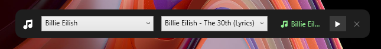

# 🎵 Taskbar Music Player

<p align="center">
  
  
  
  
</p>

<p align="center">
  
</p>

A sleek, ultra-lightweight floating music player for Windows that docks right above your taskbar. Built with **WPF (.NET 10)** and powered by **YoutubeExplode**, it lets you browse popular artists, search tracks on YouTube, and stream audio seamlessly in the background without opening heavy browser tabs.

---

## ✨ Features

- 🛸 **Floating Taskbar Widget:** Always-on-top, compact floating bar positioned right above your taskbar.
- 🖐️ **Draggable Anywhere:** Click and drag anywhere on the widget to reposition it freely across your monitors.
- 🎤 **Popular Artists & Quick Search:** Preloaded with top international artists and instant YouTube search for discographies.
- ⚡ **Smart Local Audio Caching:** Streams are automatically buffered and cached in your temp directory for instantaneous replay (0 ms latency) and offline re-listening.
- 🎧 **Optimized Playback:** Native MP4/AAC stream extraction ensures smooth, crash-free playback through Windows Media Foundation.
- 🪶 **Minimal Resource Footprint:** Lightweight memory and CPU usage compared to bloated desktop clients or browser tabs.

---

## 🚀 Getting Started

### Prerequisites

- **Windows 10 / 11**
- [.NET 10.0 SDK](https://dotnet.microsoft.com/download) (or .NET 8.0+ if modified)

### Installation & Running

1. **Clone the repository:**
   ```bash
   git clone https://github.com/selfi123/Taskbar-Music-Player.git
   cd Taskbar-Music-Player
   ```

2. **Restore dependencies & build:**
   ```bash
   dotnet build
   ```

3. **Launch the player:**
   ```bash
   dotnet run
   ```

---

## 🛠️ Tech Stack

- **Framework:** .NET 10.0 Windows (WPF)
- **Audio Engine:** System.Windows.Controls.MediaElement / Windows Media Foundation
- **Stream Extraction:** [YoutubeExplode](https://github.com/Tyrrrz/YoutubeExplode) (v6.6.3+)
- **Styling:** Custom dark-mode transparent floating UI

---

## 🗺️ Roadmap

- [ ] Custom artist / song search input box
- [ ] Volume slider and media seek bar
- [ ] Global hotkeys (Play / Pause / Next from anywhere)
- [ ] Mini album art preview

---

## 🤝 Contributing

Contributions, issues, and feature requests are welcome!  
Feel free to open an issue or submit a pull request.

---

## 📄 License

Distributed under the **MIT License**. See [LICENSE](LICENSE) for more information.

---

<p align="center">
  <b>⭐ If you like this project, please consider giving it a star on GitHub! It helps others discover it. ⭐</b>
</p>
